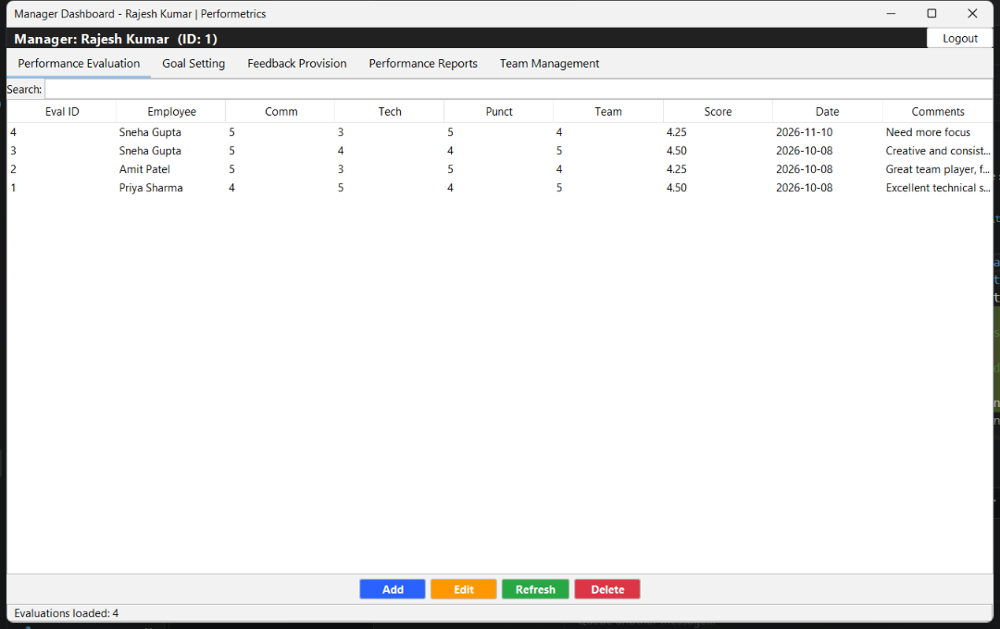
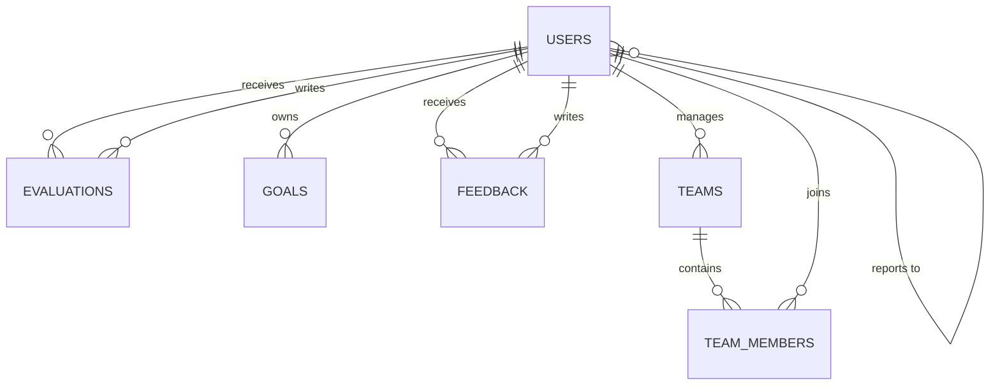
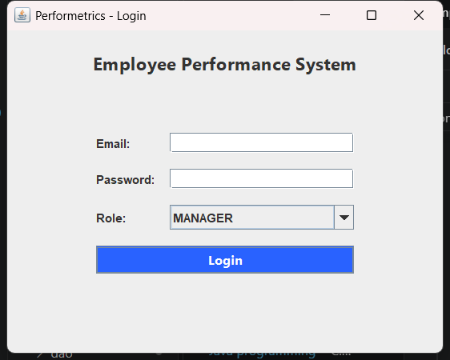
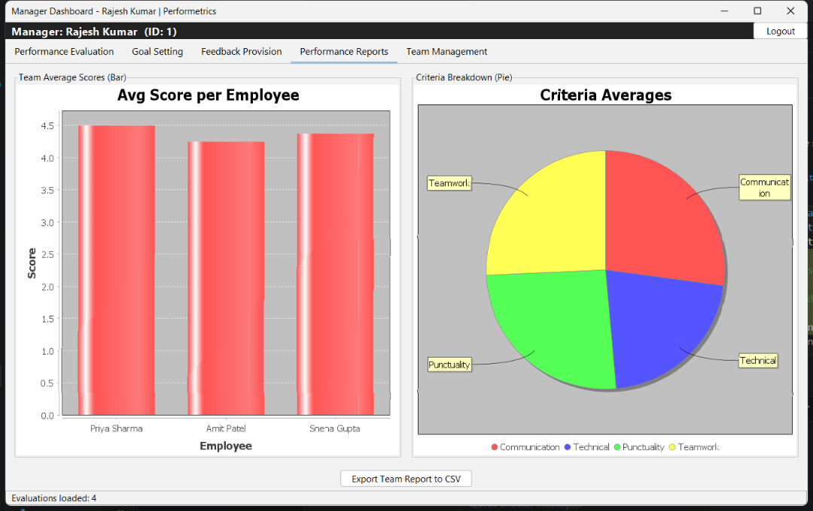
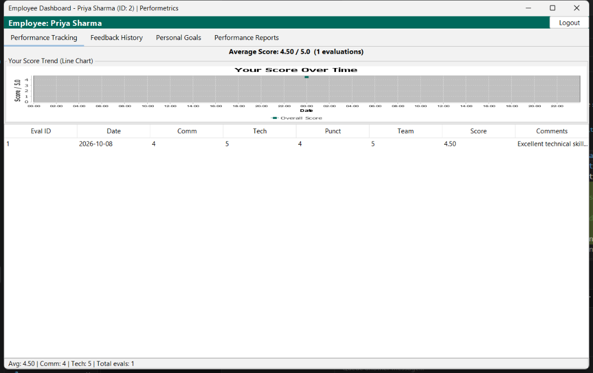
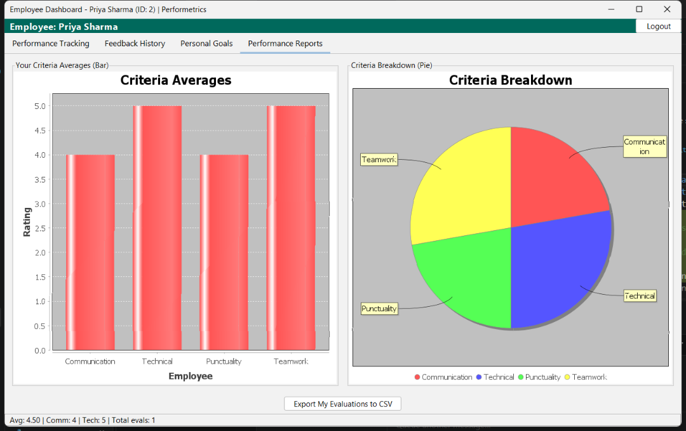

# Performetrics — Employee Performance Evaluation System

> GUVI HCL Hackathon · Problem #18 · Core Java (Swing + JDBC + JFreeChart)

A desktop application where managers evaluate employee performance, set goals,
give feedback and generate reports — while employees track their progress, read
feedback and manage their own goals.



---

## Table of contents

1. [Features](#features)
2. [Tech stack](#tech-stack)
3. [Requirements](#requirements)
4. [Setup](#setup)
5. [Running the application](#running-the-application)
6. [Running the tests](#running-the-tests)
7. [Demo credentials](#demo-credentials)
8. [Project structure](#project-structure)
9. [Architecture](#architecture)
10. [Database design](#database-design)
11. [Security](#security)
12. [Screenshots](#screenshots)
13. [Presentation](#presentation)
14. [License](#license)

---

## Features

### Manager dashboard

| Tab | What it does |
|---|---|
| **Performance Evaluation** | Add, edit and delete evaluations rated on Communication, Technical, Punctuality and Teamwork (1–5). Debounced, SQL-side search over employee name and comments. |
| **Goal Setting** | Assign goals to any team member with a target date and a status that moves through Pending → In Progress → Completed. |
| **Feedback Provision** | Give written feedback with a 1–5 rating, optionally linked to an evaluation. |
| **Performance Reports** | Bar chart of the average score per employee and a pie chart of the team criteria averages, both computed by SQL aggregation. Export to CSV. |
| **Team Management** | Add employees to teams, change a member's role, and remove them. |

### Employee dashboard

| Tab | What it does |
|---|---|
| **Performance Tracking** | A line chart of the employee's score over time plus the full evaluation history and the running average. |
| **Feedback History** | Every piece of feedback the employee has received, with the rating and the date. |
| **Personal Goals** | Set personal goals, edit them, mark them complete, delete them, and see the status breakdown in a pie chart. |
| **Performance Reports** | Bar and pie charts of the employee's own criteria averages, with CSV export. |

Every query in the employee dashboard is filtered by the signed-in employee's
id, and every write is re-checked against that id in SQL — an employee cannot
reach another employee's rows by guessing an id.

---

## Tech stack

| Layer | Technology |
|---|---|
| Language | Java 17+ (developed and tested on JDK 21) |
| UI | Java Swing with the FlatLaf 3.4.1 look and feel |
| Database | MySQL 8.0 via JDBC (`mysql-connector-j` 8.0.33) |
| Charts | JFreeChart 1.5.4 (line, bar, pie) |
| Security | PBKDF2-HMAC-SHA256 password hashing, 210 000 iterations |
| Concurrency | `SwingWorker` for off-thread I/O, `ArrayBlockingQueue` connection pool |
| Tests | JUnit 5 (66 tests) |
| Build | Maven (`pom.xml`) — or the included `run-tests.bat`, which needs no Maven |

---

## Requirements

- **JDK 17 or newer** (the `release` target in `pom.xml` is 17)
- **MySQL 8.0 or newer**
- The dependency jars, already included in `lib/`:
  - `flatlaf-3.4.1.jar`
  - `jfreechart-1.5.4.jar`
  - `mysql-connector-j-8.0.33.jar`
  - `junit-platform-console-standalone-1.10.2.jar` — only needed by
    `run-tests.bat`; Maven fetches its own copy.

---

## Setup

### 1. Get the code

```bash
git clone https://github.com/Harshitsingh798/EmployeePerformanceSystem.git
cd EmployeePerformanceSystem
```

### 2. Create and populate the database

Run the three scripts in this order. From a terminal:

```bash
mysql -u root -p < db/schema.sql
mysql -u root -p < db/seed_data.sql
mysql -u root -p < db/migration_v2.sql
```

Or open each file in MySQL Workbench and run them in the same order.

> **Order matters.** `schema.sql` creates the tables, `seed_data.sql` inserts
> the demo accounts and data, and `migration_v2.sql` widens the password
> column and converts the demo accounts to PBKDF2 hashes. Running the seed
> first would fail because the tables would not exist yet.

### 3. Configure the connection

Copy `db.properties.example` to `db.properties` and edit it:

```properties
db.url=jdbc:mysql://localhost:3306/employee_performance_db
db.user=root
db.password=your_password
```

The file is read from the working directory first and from the classpath as a
fallback. If it is missing, the defaults above (with an empty password) are
used.

### 4. Start MySQL

`start-mysql.bat` starts a local MySQL 8 server if one is installed but not
running. Otherwise just start the service the usual way.

---

## Running the application

### From VS Code

Open the folder, make sure `lib/` is on the classpath (`.vscode/settings.json`
already does this), and run `src/App.java`.

### From a terminal

```bash
javac -encoding UTF-8 -cp "lib/*" -d bin -sourcepath src src/App.java
java -cp "bin;lib/*" App
```

### With Maven

```bash
mvn clean package
java -jar target/employee-performance-system-2.0.0.jar
```

### A quick sanity check

```bash
java -cp "bin;lib/*" tools.SmokeTest
```

This runs 20 end-to-end checks against the live database — authentication, the
ownership rules and the password hashing — and prints one line per check.

---

## Running the tests

66 tests cover the model layer, the validation rules, the CSV exporter, the
password hashing and the DAO layer against a real MySQL database.

```bash
run-tests.bat
```

The script needs only a JDK and the jars in `lib/` — **no Maven required**.
With Maven installed, `mvn test` runs exactly the same tests.

The DAO integration tests need a running MySQL with the seed data loaded.
Without a database they are **skipped**, not failed, so the suite still passes
on a machine that has no MySQL.

---

## Demo credentials

| Role | E-mail | Password |
|---|---|---|
| Manager | `manager@company.com` | `manager123` |
| Employee | `priya@company.com` | `emp123` |
| Employee | `amit@company.com` | `emp123` |
| Employee | `sneha@company.com` | `emp123` |

These accounts are stored as PBKDF2 hashes. To give an account a new
password, generate a hash and run the resulting statement:

```bash
java -cp "bin;lib/*" util.PasswordHashTool "MyNewPassword"
```

---

## Project structure

```
EmployeePerformanceSystem/
├── pom.xml                   # Maven build (JUnit 5, shade plugin)
├── run.bat                   # Compiles and starts the app (no Maven needed)
├── run-tests.bat             # Runs the tests without Maven
├── start-mysql.bat           # Starts a local MySQL if it is not running
├── gen_ppt.py                # Generates the Review 2 presentation
├── db.properties             # Your local DB connection settings
├── db.properties.example     # Template for db.properties
│
├── db/
│   ├── schema.sql            # Tables, constraints, foreign keys
│   ├── seed_data.sql         # Demo users, evaluations, goals, feedback, teams
│   └── migration_v2.sql      # Widens the password column, applies PBKDF2
│
├── docs/
│   ├── ARCHITECTURE.md       # Layer diagram and design decisions
│   ├── ER_DIAGRAM.md         # Entity-relationship diagram (Mermaid)
│   ├── AUDIT_REPORT.md       # Code review: issues found and fixes applied
│   ├── screenshots/          # Real screenshots of the running app
│   ├── Review1_Performetrics_Presentation.pptx
│   └── Review2_Final_Performetrics.pptx
│
├── lib/                      # flatlaf, jfreechart, mysql-connector-j, junit
│
└── src/
    ├── App.java              # Entry point: theme, DB check, shutdown hook
    ├── model/                # User, Manager, Employee, Evaluation, Goal, Feedback, Team
    ├── dao/                  # DAO<T>, DatabaseConnection, ConnectionPool, *DAO
    ├── service/              # ReportService
    ├── ui/                   # LoginFrame, ManagerDashboard, EmployeeDashboard
    │   └── components/       # ChartPanel (JFreeChart wrapper)
    ├── util/                 # PasswordUtil, Validator, ReportExporter, FileLogger,
    │                         #   Icons, PasswordHashTool
    ├── exception/            # InvalidRatingException, GoalDeadlineException
    ├── tools/                # SmokeTest, ScreenshotTool
    └── test/java/            # JUnit 5 test suite (66 tests)
```

---

## Architecture

A classic three-layer design, with the layers depending only on the one below:

```
┌──────────────────────────────────────────────┐
│  ui/        Swing windows, dashboards, charts │
├──────────────────────────────────────────────┤
│  service/   ReportService — reporting rules   │
├──────────────────────────────────────────────┤
│  dao/       DAO<T> + *DAO + ConnectionPool    │
├──────────────────────────────────────────────┤
│  model/     User, Evaluation, Goal, Feedback  │
└──────────────────────────────────────────────┘
            ↑ util/ (validation, hashing, export, logging)
```

- **`DAO<T>`** is a generic interface, so every DAO implements the same
  contract and the collections code stays type-safe.
- **`DatabaseConnection`** is a singleton that owns a small
  **`ConnectionPool`**. The pool hands out connections from an
  `ArrayBlockingQueue`; a `java.lang.reflect.Proxy` intercepts
  `Connection.close()` so closing a borrowed connection returns it to the pool
  instead of closing it for real.
- **All database work runs on a `SwingWorker`**, so the interface never
  freezes while a query is running.
- **Ownership is enforced in SQL** (`WHERE assigned_to = ?`,
  `WHERE manager_id = ?`), not in the interface — a bug in the UI cannot leak
  another user's data.

More detail is in [`docs/ARCHITECTURE.md`](docs/ARCHITECTURE.md).

---

## Database design



The full schema — with the foreign keys, the `CHECK` constraints on the
ratings and the enum columns — is in [`db/schema.sql`](db/schema.sql).

---

## Security

| Concern | How it is handled |
|---|---|
| Password storage | PBKDF2-HMAC-SHA256, 210 000 iterations, a random 16-byte salt per password, constant-time comparison |
| Legacy accounts | Plain-text and SHA-256 rows still verify, and are silently upgraded to PBKDF2 on the first successful sign-in |
| SQL injection | Every query uses a `PreparedStatement` with bound parameters |
| Broken access control | Ownership is a `WHERE` clause on every read and write, verified by the integration tests |
| CSV injection | Exported values that start with `=`, `+`, `-` or `@` are prefixed with an apostrophe |
| Resource leaks | try-with-resources throughout; the pool is closed by a shutdown hook |
| Errors | `SQLException` is never swallowed — every catch block logs and shows a real message |

---

## Screenshots

| | |
|---|---|
|  |  |
| **Login** | **Manager — performance reports** |
|  |  |
| **Employee — performance tracking** | **Employee — performance reports** |

Every screenshot was captured from the running application against the live
database, using `src/tools/ScreenshotTool.java`.

---

## Presentation

The Review 2 presentation is in
[`docs/Review2_Final_Performetrics.pptx`](docs/Review2_Final_Performetrics.pptx)
— ten slides covering the problem, the architecture, the database design, the
security work, the test suite, the audit fixes and the delivered features, with
the screenshots above. It is generated by `gen_ppt.py`:

```bash
pip install python-pptx
python gen_ppt.py
```

---

## License

Academic project for the GUVI HCL Hackathon, Review 2.
