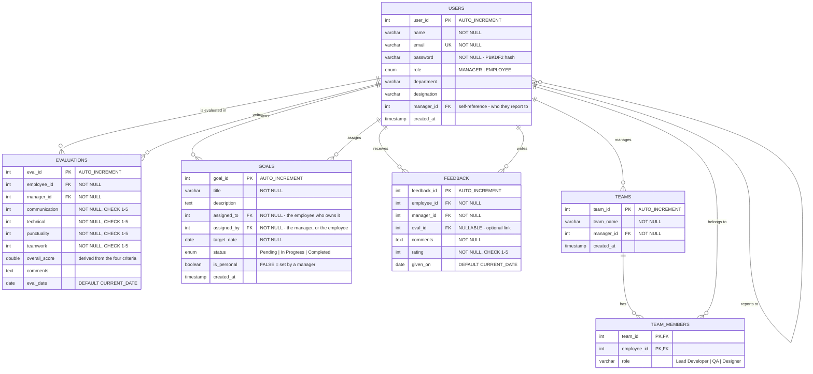

# Entity–Relationship Diagram

The database has **six tables**. The diagram below is the same schema that
`db/schema.sql` creates.

## Relationships in words

| Relationship | Cardinality | Meaning |
|---|---|---|
| `users` → `evaluations` | 1 : N | One employee has many evaluations; one manager writes many |
| `users` → `users` | 1 : N | A manager manages many employees, through `manager_id` |
| `users` → `goals` | 1 : N | A goal belongs to one employee (`assigned_to`) and was set by one person (`assigned_by`) |
| `users` → `feedback` | 1 : N | Feedback runs from a manager to an employee, optionally linked to an evaluation |
| `users` → `teams` | 1 : N | A manager owns the teams they created |
| `users` ↔ `teams` | N : N | Through the `team_members` junction table |

## Design notes

- **One `goals` table, not two.** Manager-assigned goals and employee personal
  goals share the same columns and differ only by the `is_personal` flag, so
  progress can be reported on them uniformly.
- **`assigned_to` and `assigned_by` are different.** A personal goal has the
  employee in both columns; a manager-assigned goal has the employee in
  `assigned_to` and the manager in `assigned_by`. Both columns are foreign
  keys with `ON DELETE CASCADE`, so removing a user removes their goals.
- **Ratings are `NOT NULL` as well as `CHECK`-constrained.** A `CHECK` alone
  still permits `NULL`, and a `NULL` rating would break the score calculation.
- **`overall_score` is always derived.** The application writes it from the
  four criteria so it can never disagree with them.
- **`team_members.role`** is a free-text column, because the role a person
  plays in a team (Lead Developer, QA, Designer) is team-specific rather than
  a property of the user.
